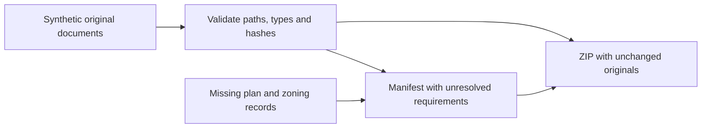

# Appraisal workfile audit — synthetic demonstration

> **Proprietary - All Rights Reserved.** Licensed to Sandeep Grover. No reuse, copying, modification, or distribution without prior written permission. See LICENSE.

This small Python component keeps source documents unchanged, distinguishes document types, validates their hashes and exports a ZIP with a provenance manifest. All supplied records are fictional. It is not a Massachusetts records connector or a completed appraisal application.



## Run

Requires Python 3.10 or later; runtime uses the standard library only.

```sh
python main.py --output demo_output
python -m unittest -v test_workfile
```

The demo creates two synthetic SVG documents and a ZIP. A recorded plan and zoning evidence remain unresolved. An assessor map is never silently substituted for a recorded plan. Choose a new output directory for another run: existing outputs are preserved.

Open `sample.html` in a browser for the separate interactive canvas example. Select a fictional source, drag a crop and download a PNG. The original canvas remains unchanged. The Python ZIP exporter and browser demo are separate components, not an integrated production application.

## Checks and limitations

Twelve tests cover original bytes, unresolved document types, hash mismatches, duplicate identifiers, unsafe paths, symlink escapes, missing provenance and preservation of an existing export. Hash validation establishes consistency with the supplied manifest, not document authenticity. Source URLs and timestamps are recorded metadata, not independently verified facts.

No live connectors, identity/access system, PDF parser/export, clipboard integration, hosted storage, OCR or automated zoning determination are included. The UI sample uses synthetic images; its proposed implementation plan describes future work. Public records access, licensing and automation permissions require source-specific assessment. This code does not provide legal, title, flood-risk or appraisal certification.
